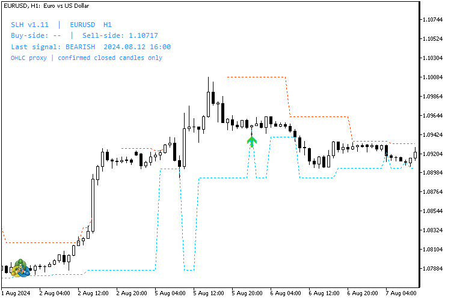
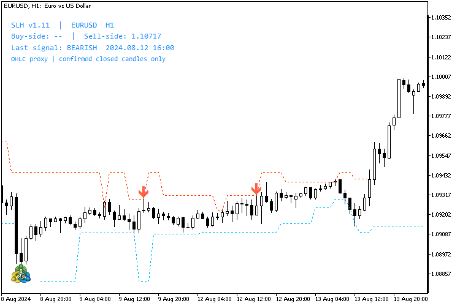

# Smart Liquidity Hunter — MT4 & MT5

**Free, open-source liquidity-sweep indicator for MetaTrader 4 and MetaTrader 5.** Smart Liquidity Hunter highlights *price-action sweeps* of previously confirmed swing highs and lows on **closed candles**. The algorithm uses OHLC candles, not exchange order-book or broker stop data.

[**Download v1.11 (MT4 + MT5)**](https://github.com/fxliner/smart-liquidity-hunter-mt4-mt5/releases/tag/v1.11) · [**Full indicator guide**](https://forexsignal24.com/smart-liquidity-hunter/) · [**FOREXREVIEW.TOP**](https://forexreview.top/)

## What you can analyze

- **Bullish sweep:** price pierces a previously confirmed swing low by the required distance, then closes above that level.
- **Bearish sweep:** price pierces a previously confirmed swing high, then closes below the level.
- **Filters:** swing strength, level freshness, penetration threshold, mean true range, rejection wick, candle close location, and optional candle direction.
- **Chart output:** sweep arrows, optional reference levels and compact dashboard. Optional popup, sound and push notifications are **off by default**.
- **No trading automation:** this indicator does not open orders, identify actual stop orders, or guarantee reversals.

## See the indicator

*Example MT5 chart showing a bullish sweep.*

*Example MT5 chart showing a bearish sweep.*

## Quick start

1. [Download the v1.11 ZIP](https://github.com/fxliner/smart-liquidity-hunter-mt4-mt5/releases/download/v1.11/smart-liquidity-hunter-mt4-mt5-v1.11.zip).
2. Extract it. For **MT4**, place the `.ex4` file from `bin/MT4/` in `MQL4/Indicators/`; for **MT5**, place the `.ex5` file from `bin/MT5/` in `MQL5/Indicators/`. Use **File → Open Data Folder**.
3. Restart or refresh the Indicators section of Navigator, then attach the indicator to a chart with sufficient history.
4. Start with default parameters; enable alerts only if required. This is an **indicator**, not an Expert Advisor.

## Documentation

| Guide | Contents |
| --- | --- |
| [Installation](docs/installation.md) | MT4/MT5 steps, files, troubleshooting |
| [Parameters](docs/parameters.md) | Exact source input names and defaults |
| [Methodology](docs/methodology.md) | Confirmed pivots, sweep formula, closed-bar behavior |
| [Examples](docs/examples.md) | Illustrative bullish and bearish patterns |
| [FAQ](docs/faq.md) | Anti-repaint limitations, alerts, setup questions |
| [Validation](docs/validation.md) | Reproducible manual QA checklist |

## Official downloads and developer resources

- [GitHub Releases](https://github.com/fxliner/smart-liquidity-hunter-mt4-mt5/releases/latest) · [SourceForge](https://sourceforge.net/projects/smart-liquidity-hunter/)
- [MQL5 Market listing](https://www.mql5.com/en/market/product/209580)
- [MQL5 Code Base MT4](https://www.mql5.com/en/code/79545) · [MT5](https://www.mql5.com/en/code/79546)
- [Extended tutorial — FOREXSIGNAL24](https://forexsignal24.com/smart-liquidity-hunter/)
- [Developer hub and independent forex education — FOREXREVIEW.TOP](https://forexreview.top/)

**License:** [MIT](LICENSE). For bugs, use [GitHub Issues](https://github.com/fxliner/smart-liquidity-hunter-mt4-mt5/issues/new/choose) with symbol, timeframe, terminal build and settings. Never include passwords or account identifiers.

**Risk notice:** Historical candle patterns are not proof of actual institutional liquidity or a recommendation to trade. Changes to broker history or parameters can change historical output. Trading involves risk.
